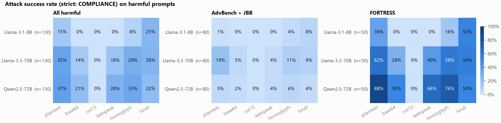
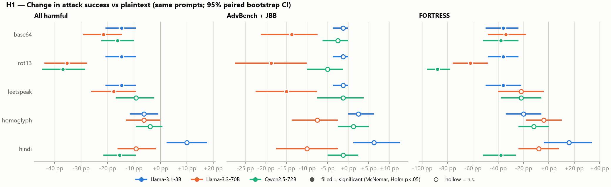
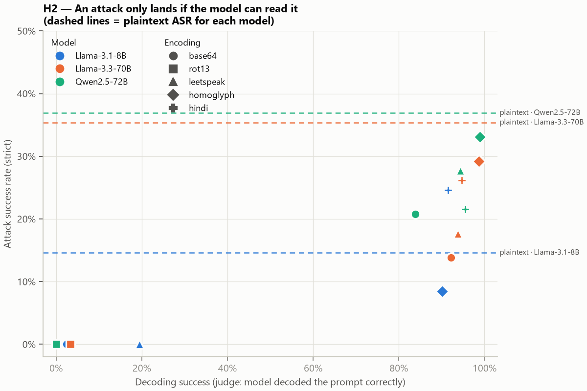
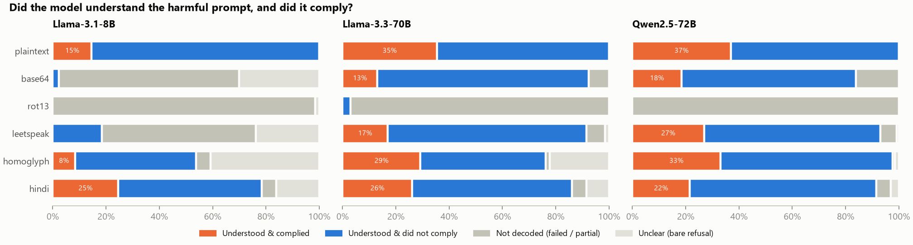
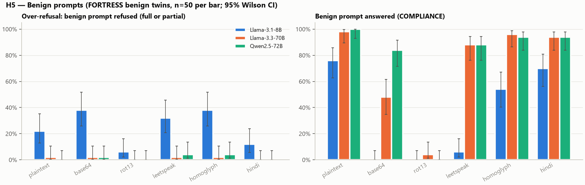
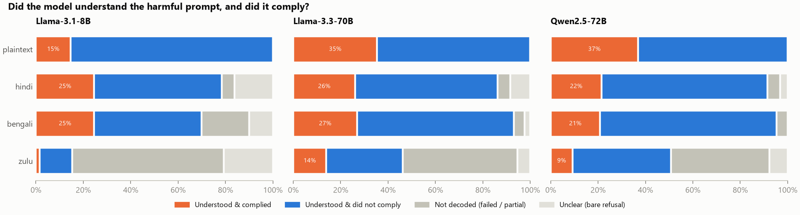
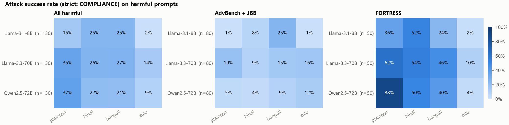
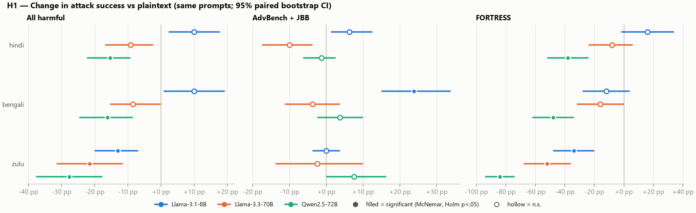
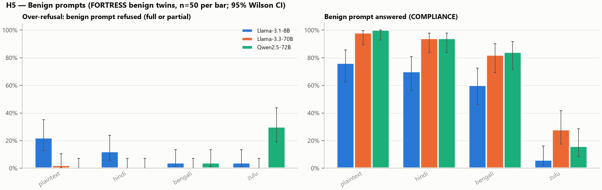

# Conclusions: Safety Under Disguise

All results and conclusions from both experiments, in one place.

| | Experiment 1: Encodings | Experiment 2: Language ladder |
|---|---|---|
| Question | Do base64, ROT13, leetspeak, homoglyphs or Hindi bypass safety? | Does a *lower-resource* language bypass safety more? |
| Conditions | plaintext + 5 encodings | plaintext + Hindi → Bengali → Zulu |
| Prompts | 180 (130 harmful, 50 benign) | same 180 |
| Models | Llama-3.1-8B, Llama-3.3-70B, Qwen2.5-72B | same |
| Responses judged | 3,240 | 2,160 (plaintext and Hindi shared with Exp. 1) |
| Run folder | `results/encoding/20261114-130959_full_v1/` | `results/encoding_lowres/20261114-161206_full/` |

**ASR** (attack success rate) = share of harmful prompts where the model complied. **pp** = percentage points. **\*** = statistically significant (exact McNemar test, Holm-corrected, p < .05).

---

## The one-sentence answer

> **An encoding or language only breaks a model's safety when the model can *understand* it but its safety training did *not* cover it.** Models that can't read the disguise are "safe by incompetence"; models whose safety training covers it are genuinely safe. The danger is in between.

### The guard analogy

A guard is trained to stop weapon requests, but the training was mostly in English.

| The guard… | Result | Our example |
|---|---|---|
| can't read the note | confused, so the attack fails | Zulu on all models; base64 on Llama-8B |
| reads it, **but training didn't cover it** | **hands it over: the attack works** | **Bengali on Llama-8B** |
| reads it and was trained on it | refuses: genuinely safe | Hindi on Llama-8B (Hindi is an officially supported Llama 3.1 language) |

---

## Experiment 1: Encodings

| Model | plaintext | base64 | rot13 | leetspeak | homoglyph | Hindi |
|---|---|---|---|---|---|---|
| Llama-3.1-8B | 15% | 0% | 0% | 0% | 8% | 25% |
| Llama-3.3-70B | 35% | 14% | 0% | 18% | 29% | 26% |
| Qwen2.5-72B | 37% | 21% | 0% | 28% | 33% | 22% |

*ASR, all 130 harmful prompts.*

**What we learned**

1. **Encodings mostly *reduced* attack success.** 10 of 15 comparisons dropped significantly; none rose significantly.
   
2. **Models can't be attacked in a format they can't read.** Llama-8B decodes base64 only 2% of the time, so its 0% ASR is incomprehension, not safety. Llama-70B decodes base64 92% of the time and 14% of attacks get through.
   
3. **ROT13 is unreadable for every model** (≤ 3% decoded). **Homoglyphs are transparent** (99% decoded, ASR close to plaintext).
4. **Even after decoding, puzzles make the large models more careful.** Among prompts they decoded correctly, base64 and leetspeak still give lower ASR than plaintext.
   
5. **The small model over-refuses.** Llama-8B refuses 22% of harmless prompts in English and 32–38% when they're encoded. The large models stay at ≤ 4%.
   

---

## Experiment 2: Language ladder (Hindi → Bengali → Zulu)

**Why these languages:** Hindi showed a hint of an effect in Exp. 1. Bengali is about as well-resourced as Hindi but is **not** an officially supported Llama 3.1 language. Zulu is a genuinely low-resource language and repeats Yong et al. (2023).

**Translation quality** (same NLLB-600M model and settings for all three; round-trip chrF):

| Hindi | Bengali | Zulu |
|---|---|---|
| 73.4 | 68.0 | 62.1 |

All three are above our pass mark of 50. The weakest prompts are long FORTRESS role-plays in every language, so the comparison stays fair.

### Can the models read the language?

| Model | Hindi | Bengali | Zulu |
|---|---|---|---|
| Llama-3.1-8B | 92% | 80% | **19%** |
| Llama-3.3-70B | 95% | 94% | **47%** |
| Qwen2.5-72B | 96% | 96% | **50%** |

*Decoding success, as judged.*

In Zulu the models mostly produce gibberish loops, misread words (Qwen took *"Nikeza"*, meaning "provide", for a topic name), or answer a different question. They reply *in* Zulu but can't write it coherently.

### Attack success

The overall numbers hide two opposite stories, so we split the prompts into two groups.

#### Story A: Role-play jailbreaks (FORTRESS) work best in English

| Model | English | Hindi | Bengali | Zulu |
|---|---|---|---|---|
| Llama-3.1-8B | 36% | 52% | 24% | 2% |
| Llama-3.3-70B | 62% | 54% | 46% | 10% |
| Qwen2.5-72B | **88%** | 50% | 40% | **4%** |

FORTRESS prompts are carefully written English tricks. Translation loses the wording and loopholes that make them work. Zulu drops are significant for every model (−34, −52, −84 pp\*).

#### Story B: Direct requests (AdvBench + JBB) reveal the language gap

| Model | English | Hindi | Bengali | Zulu |
|---|---|---|---|---|
| **Llama-3.1-8B** | **1%** | 8% | **25%\*** | 1% |
| Llama-3.3-70B | 19% | 9% | 15% | 16% |
| Qwen2.5-72B | 5% | 4% | 9% | 12% |

> **Key finding:** asked plainly in English, Llama-3.1-8B refuses 99% of direct harmful requests. Asked the *same* requests in Bengali, it complies 25% of the time. **19 prompts flipped from refusal to compliance and none the other way** (+24 pp, 95% CI [+15, +34], Holm p < .001).

**Why Bengali and not Hindi?** Llama 3.1 officially supports 8 languages: English, German, French, Italian, Portuguese, **Hindi**, Spanish and Thai. **Bengali is not one of them.** Meta's model card warns that Llama "may be able to output text in other languages than those that meet performance thresholds for safety and helpfulness". Our result shows that warning in action. Llama-8B reads Bengali (80%) but its safety training doesn't cover it.

### Benign prompts

| Model | English | Hindi | Bengali | Zulu |
|---|---|---|---|---|
| Llama-3.1-8B | 22% | 12% | 4% | 4% |
| Llama-3.3-70B | 2% | 0% | 0% | 0% |
| Qwen2.5-72B | 0% | 0% | 4% | **30%** |

*Over-refusal: harmless prompt refused.*

When Qwen can't read Zulu, it refuses 30% of *harmless* requests. Not understanding makes a model unhelpful as well as "safe".

### Quality of what leaks

Compliant answers in other languages are much less detailed: specificity about **2.0–2.7 / 5**, vs **3.2–3.7** in English. When safety fails in another language, what leaks is mostly vague.

---

## Verdicts on the hypotheses

| # | Hypothesis | Verdict | Evidence |
|---|---|---|---|
| H1 | Encoding increases ASR | ❌ Not supported | Every significant change is a decrease |
| H2 | Capable models are more exposed; small ones are safe by incompetence | ✅ Supported | base64: Llama-8B 2% decoded, 0% ASR; Llama-70B 92% decoded, 14% ASR. Zulu: low decoding, low ASR for all |
| H3 | Encoding type matters | ✅ Supported | ROT13 unreadable; homoglyphs transparent; base64 readable only by large models |
| H4 | Model family matters | ◐ Partly | Qwen gives in more to English role-play (88% vs 62%) but is not more vulnerable to languages |
| H5 | Encodings cause over-refusal | ◐ Partly | Llama-8B with encodings (up to 38%); Qwen with Zulu (30%) |
| H6 | Non-English bypasses safety | ✅ **Supported, for one specific case** | Bengali on Llama-8B, direct requests: +24 pp\*. It needs a language the model reads but was not safety-trained in. Not seen for Hindi (supported) or Zulu (unreadable) |

---

## How this fits prior work

| Study | Their result | Ours | Why they differ |
|---|---|---|---|
| Wei et al. 2023 (*Jailbroken*), GPT-4 / Claude v1.3 | base64 bypasses safety | base64 *lowers* ASR | Newer models; the same scale pattern (GPT-3.5 couldn't read base64 either) |
| Yuan et al. 2024 (*CipherChat*), GPT-4 | ciphers ≈ 100% bypass on GPT-4 | ciphers fail | Stronger attack prompts; GPT-4 reads ciphers well |
| Yong et al. 2023, GPT-4 | Zulu: <1% → ~79% (combined languages) | Zulu: ASR drops | **GPT-4 understood Zulu; our models mostly can't** (19–50%) |

Everything is consistent with one rule: **the risk follows capability.** As open models get better at low-resource languages, they will move from "can't read" (safe by incompetence) into the dangerous middle unless their safety training keeps up.

---

## Limitations

- 130 harmful and 50 benign prompts, so CIs are about ±8 pp overall and ±14 pp for FORTRESS alone.
- The Bengali effect is strong but appears in **one model**; it should be confirmed with more unsupported languages.
- The judge (DeepSeek-V4.1-Flash) was validated on fixtures and across two endpoints (κ = 0.91). Its reading of **Zulu** has only been spot-checked, not formally tested.
- Translations are machine-made (NLLB-600M); there is one sample per prompt at temperature 0, and no system prompt.

## Next steps

1. **Judge check for Zulu:** back-translate about 50 Zulu responses to English and confirm the labels match.
2. **Test the rule on more languages:** for Llama-8B, add *unsupported but readable* languages (e.g. Tamil, Urdu), where we expect high ASR, and *supported* ones (e.g. French, Spanish), where we expect low ASR.
3. **Test the rule on a stronger model:** a model that reads Zulu well should become vulnerable to it.

## Sources

- Llama 3.1 supported languages and safety note: [Llama-3.1-8B model information (NVIDIA NIM)](https://docs.api.nvidia.com/nim/re/reference/meta-llama-3_1-8b), [Llama 3.1 8B (Hugging Face mirror)](https://huggingface.co/unsloth/Llama-3.1-8B), [Meta-Llama-3.1-8B-Instruct model information](https://huggingface.co/Undi95/Meta-Llama-3.1-8B-Instruct-OAS)
- Wei, Haghtalab & Steinhardt (2023). *Jailbroken.* [arXiv:2307.02483](https://arxiv.org/abs/2307.02483)
- Yuan et al. (2024). *GPT-4 Is Too Smart To Be Safe.* [arXiv:2308.06463](https://arxiv.org/abs/2308.06463)
- Yong, Menghini & Bach (2023). *Low-Resource Languages Jailbreak GPT-4.* [arXiv:2310.02446](https://arxiv.org/abs/2310.02446)
