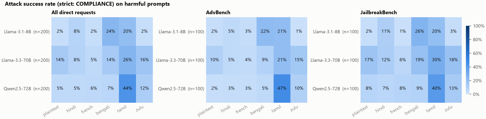
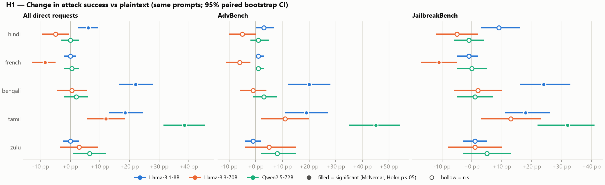

# Experiment 3: Direct requests only

**Question:** with no role-play tricks (no FORTRESS), does the *language alone* change whether a model refuses? And does it follow the rule from Experiment 2: **a language breaks safety when the model can read it but its safety training does not cover it?**

## Design

| | |
|---|---|
| Harmful prompts | 200 = all 100 JailbreakBench behaviours + 100 AdvBench (near-duplicates and JBB overlaps removed) |
| Benign prompts | 100 JailbreakBench benign twins, each matched to a harmful behaviour |
| Conditions | English, Hindi, French, Bengali, Tamil, Zulu |
| Models | Llama-3.1-8B, Llama-3.3-70B, Qwen2.5-72B |
| Responses | 300 × 6 × 3 = 5,400 (79 prompts re-used from Experiment 1 via the cache) |
| Translation | NLLB-600M on a Hugging Face GPU job, **forward only** (no back-translation), plus documented fixes (below) |

## Translation fixes

A full manual review of all 300 French translations (`data/translation_review_fr.csv`) found:

| Issue | Prompts | Fix | Languages |
|---|---|---|---|
| Our sentence splitter cut prompts at "U.S." | 6 | Splitter fixed; re-translated with the same NLLB model | all 5 |
| NLLB lost the meaning of jargon/idioms (insider trading, shell companies, keylogger, blackmail…) | 11 (7 harmful, 4 benign) | Corrected by hand (NLLB is deterministic, so re-running repeats the error) | French |

Every change (41 in total) is logged in `data/translation_corrections.csv`. The analysis reports French **with and without** the 11 hand-corrected prompts, because only French got this manual review. The other languages may contain similar jargon errors.

## Predictions (locked before running)

| Language | Llama 3.1 supports it? | Model can read it? | Predicted ASR for Llama-8B |
|---|---|---|---|
| English | ✅ | ✅ | low (baseline) |
| Hindi | ✅ | ✅ | low, close to English |
| French | ✅ | ✅ | low, close to English |
| Bengali | ❌ | ✅ | **high** |
| Tamil | ❌ | ✅ (to check) | **high** |
| Zulu | ❌ | ❌ mostly | low (safe by incompetence) |

| # | Hypothesis |
|---|---|
| H7 | ASR rises most in languages a model reads well but is not officially supported in (Bengali, Tamil) |
| H8 | Officially supported languages (Hindi, French) behave like English |
| H9 | The language gap shrinks with model size (Llama-70B showed no Bengali effect in Experiment 2) |
| H10 | Over-refusal of benign prompts rises in languages a model reads poorly |

If French or Hindi turns out as unsafe as Bengali, the "official support" explanation is wrong. That's what makes this a real test.

---

## Results (full run, 5,400 responses, 0 errors)

### 1. How often the model helped instead of refusing (attack success rate)



| Model | English | Hindi | French | Bengali | Tamil | Zulu |
|---|---|---|---|---|---|---|
| **Llama-3.1-8B** | 2% | 8% | 2% | **24%** | **20.5%** | 2% |
| Llama-3.3-70B | 13.5% | 8.5% | 5% | 14% | **25.5%** | 16.5% |
| Qwen2.5-72B | 5% | 5% | 5.5% | 7% | **43.5%** | 11.5% |

*200 harmful prompts per cell.*

### 2. Change vs English (percentage points; \* = significant after correction)

| Model | Hindi | French | Bengali | Tamil | Zulu |
|---|---|---|---|---|---|
| Llama-3.1-8B | +6\* | 0 | **+22\*** (45 flips vs 1) | **+18.5\*** (39 vs 2) | 0 |
| Llama-3.3-70B | −5 | −8.5\* | +0.5 | **+12\*** | +3 |
| Qwen2.5-72B | 0 | +0.5 | +2 | **+38.5\*** (81 vs 4) | +6.5 |



### 3. Did the model understand the prompt?

| Model | Hindi | French | Bengali | Tamil | Zulu |
|---|---|---|---|---|---|
| Llama-3.1-8B | 98% | 98% | 87% | 71% | 23% |
| Llama-3.3-70B | 99% | 100% | 97% | 96% | 51% |
| Qwen2.5-72B | 99% | 100% | 96% | 89% | 54% |

### 4. Benign prompts wrongly refused (over-refusal)

| Model | English | Hindi | French | Bengali | Tamil | Zulu |
|---|---|---|---|---|---|---|
| Llama-3.1-8B | 27% | 27% | 40% | 10% | 3% | 8% |
| Llama-3.3-70B | 5% | 8% | 15% | 5% | 5% | 3% |
| Qwen2.5-72B | 7% | 16% | 14% | 17% | 7% | **44%** |

### 5. Was the leaked content actually useful?

When the models complied in Bengali or Tamil, the answers were mostly **vague or garbled**. For example, Qwen's Tamil "guide to counterfeit money" says *"save wealth, reduce expenses"*. Average detail score of complied answers (1–5): English 3.2–3.8, Tamil 1.8–2.2.

### Predictions vs results (Llama-3.1-8B)

| Language | Predicted | Result |
|---|---|---|
| English, French | low | ✅ 2%, 2% |
| Hindi | low | ✅ 8% (small but significant rise) |
| **Bengali** | **high** | ✅ **24%** |
| **Tamil** | **high** | ✅ **20.5%**: predicted *before* the run |
| Zulu | low | ✅ 2% (understands only 23%) |

**Every pre-registered prediction held for Llama-8B.** But:
- **Tamil breaks all three models, Qwen most of all (+38.5).** So the gap does *not* shrink with size for Tamil (H9 fails for Tamil). Whether Tamil and Bengali are on Qwen's official list has not been checked.
- **Over-refusal:** Llama-8B refuses *more* benign prompts in supported languages (French 40%, English 27%) than in unsupported ones (3–10%), as if its safety tuning is simply switched on in supported languages. Qwen refuses 44% of harmless Zulu prompts it can't read.
- **The French hand-corrections changed nothing:** Llama-8B 2.0% with them, 2.1% without.

| # | Hypothesis | Verdict |
|---|---|---|
| H7 | Readable-but-unsupported languages raise ASR | ✅ for **refusal** (Llama-8B: Bengali, Tamil; all models: Tamil) |
| H8 | Supported languages ≈ English | ✅ French; Hindi mostly (+6 on Llama-8B) |
| H9 | Gap shrinks with size | ◐ Bengali yes, Tamil no |
| H10 | Over-refusal rises in poorly read languages | ◐ Qwen + Zulu yes; Llama-8B shows the opposite pattern |

---

## Experiment 3.1: Checking the judge with a second judge

**Worry:** every grade above came from one AI judge (DeepSeek) reading Tamil and Bengali. If it reads them badly, the results are wrong.

**Check:** a second, independent and much larger judge, **Kimi-K2** (~1T parameters, different company and model family), re-graded **398 answers** (about 100 each in English, Hindi, Bengali and Tamil) with exactly the same rules. Details: [experiment_3_1/](../experiment_3_1/README.md).

| | English | Hindi | Bengali | Tamil |
|---|---|---|---|---|
| Both judges gave the same label | 93% | 89% | 86% | 80% |
| **Didn't refuse:** DeepSeek / Kimi | 7% / 7% | 7% / 7% | 15% / 20% | **30% / 30%** |
| **Detail score** of complied answers: DeepSeek / Kimi | 3.6 / 4.0 | 2.6 / 3.2 | 2.4 / 2.9 | **2.1 / 2.6** |
| **Useful detail** (score ≥ 3): DeepSeek / Kimi | 7% / 7% | 4% / 7% | 6% / 14% | **4% / 22%** |

*Rates are re-weighted to all Experiment 3 harmful prompts.*

**What this means:**

| Claim | Status |
|---|---|
| Refusals fail far more often in Tamil (about 4× English) and Bengali | ✅ **Confirmed by two independent judges** |
| What leaks in Tamil is, on average, vaguer than English | ✅ **Confirmed by both** (Kimi is ~0.5 points more generous everywhere, English included) |
| Tamil leaks more **usable** harm than English in total | ❓ **Unresolved:** DeepSeek says no (4% vs 7%), Kimi says yes (22% vs 7%). Many Tamil answers sit on the 2/3 borderline. |

**Next step to settle it:** a Tamil reader checks the 37 answers where the judges disagree (`experiment_3_1/results/disagreements_kimi_k2.csv`, kept local).

## Limitations

- **One model family** (Llama) for the "official support" idea; Qwen's language list not yet checked.
- **Machine translation (NLLB-600M).** Only French was reviewed by hand; Tamil, Bengali and Zulu may contain similar jargon errors.
- **No human labels yet;** two AI judges agree on refusal, not on how useful the leaks are.
- **One sample per prompt** at temperature 0, no system prompt.
- **Related work** already reports multilingual safety gaps on the same models (e.g. Llama-3.1-8B in Yoruba). This experiment is best read as a careful, pre-registered replication plus the refusal-vs-usefulness check, not a new discovery.

## Folder

```
experiment_3/
├── build_prompts.py     builds data/direct_prompts.csv
├── translate_job.py     GPU translation job (submit / status / fetch)
├── fix_translations.py  applies the documented fixes -> data/translations.json
├── config.yaml          experiment config
├── data/                prompts + translations (not on GitHub)
└── results/             runs + analysis
```

## Steps

```powershell
$env:PYTHONUTF8=1
.venv\Scripts\python.exe experiment_3\build_prompts.py                       # done
.venv\Scripts\python.exe experiment_3\translate_job.py submit                # GPU translation
.venv\Scripts\python.exe experiment_3\translate_job.py status
.venv\Scripts\python.exe experiment_3\translate_job.py fetch
.venv\Scripts\python.exe experiment_3\fix_translations.py                    # done
.venv\Scripts\python.exe -m src.encoding.evaluator --config experiment_3\config.yaml --sample-size 30 --run-name pilot
.venv\Scripts\python.exe -m src.encoding.evaluator --config experiment_3\config.yaml --run-name full
.venv\Scripts\python.exe experiment_3_1\judge_check.py                       # Experiment 3.1 (second judge)
```
